<!-- The card and both tables rebuild themselves every day: scripts/build_card.py, run by .github/workflows/refresh.yml -->

  <picture>
    <source media="(prefers-color-scheme: dark)" srcset="./assets/card-dark.svg">
    
  </picture>

  I ship AI systems and then try to break them: a language model running bare metal on an FPGA, eval harnesses that run the code instead of asking a model, and agent fleets whose planner prices the job before anything spawns.

  <a href="https://www.linkedin.com/in/wilson1wu/">LinkedIn</a> ·
  <a href="https://github.com/wilsonwu-ai?tab=repositories&type=source">Every original repo</a>

### 🛠️ Fresh off the workbench

<!-- LATEST:START -->
| Shipped | Project | What it is |
|:--|:--|:--|
| Nov 7 | [**leveraged-buyouts-explained**](https://github.com/wilsonwu-ai/leveraged-buyouts-explained) · [live](https://wilsonwu-ai.github.io/leveraged-buyouts-explained/) | Leveraged buyouts, explained: search funds and ETA in plain language. |
| Nov 7 | [**memory-dream**](https://github.com/wilsonwu-ai/memory-dream) | Read-only audit of Claude Code's memory folders: reports what a clean-up pass would fix and prints a proposed plan. |
| Nov 7 | [**hyperscalers-explained**](https://github.com/wilsonwu-ai/hyperscalers-explained) | How hyperscalers make money, what the AI build-out costs, who pays for it, and what has to be true for it to pay off. |
| Nov 5 | [**buying-a-business-explained**](https://github.com/wilsonwu-ai/buying-a-business-explained) · [live](https://wilsonwu-ai.github.io/buying-a-business-explained/) | How a small-business acquisition gets paid for: the capital stack, leveraged buyouts, the SBA 5% own-cash rule and what… |
| Nov 5 | [**before-you-type**](https://github.com/wilsonwu-ai/before-you-type) | See how many tokens your coding agent sends with your first message, week by week, and what that first request is made… |
<!-- LATEST:END -->

My five newest portfolio repos, pulled from the GitHub API every morning.

### ⭐ Greatest hits

<!-- HITS:START -->
| | Project | What it is |
|:-:|:--|:--|
| 🔌 | [**vibe-silicon**](https://github.com/wilsonwu-ai/vibe-silicon) | We configured Intel's prebuilt Nios II soft core into an Intel MAX 10 FPGA (DE10-Lite) that had no processor, then ran llama2.c on it bare metal. |
| 🧪 | [**smoleval**](https://github.com/wilsonwu-ai/smoleval) | Eval harness for small code models: HumanEval + MBPP, sandboxed execution, unbiased pass@k, held-out set locking. |
| 🧠 | [**reasoning-over-recall**](https://github.com/wilsonwu-ai/reasoning-over-recall) | Why you'd train a small language model to reason instead of memorize - a plain-language explainer checked against the phi-1 paper, plus a working… |
| 🕸️ | [**graph-engineering-kit**](https://github.com/wilsonwu-ai/graph-engineering-kit) | The runnable half of graph engineering. A planner that prices a job before spawning it, ten rules that stop the three failure modes, four production… |
| ⚡ | [**local-llm-decode-ceiling**](https://github.com/wilsonwu-ai/local-llm-decode-ceiling) | Why local LLM decoding on Apple Silicon reaches only half its memory-bandwidth ceiling, and what speculative decoding wins back. |
| 💧 | [**why-ai-needs-water**](https://github.com/wilsonwu-ai/why-ai-needs-water) · [live](https://wilsonwu-ai.github.io/why-ai-needs-water/) | A 3D liquid-cooled GPU server loop you can take apart in your browser. One input drives every gauge. |
<!-- HITS:END -->

### 🐍 Meanwhile, a snake is eating my contribution graph

<picture>
  <source media="(prefers-color-scheme: dark)" srcset="./assets/snake-dark.svg">
  
</picture>

<b>How this profile builds itself</b>

 

- **The portrait** is my headshot turned into type by [`scripts/ascii_portrait.py`](scripts/ascii_portrait.py): background removed, local contrast lifted, then every cell mapped onto a 20-step ramp of characters, mostly letters, sorted by how much ink each one puts down. The photo never enters the repo, only the letters.
- **Easter egg:** the mid-tones of that ramp are `l i s u n o w`, the letters of my name, so wherever the photo sits in the mid-greys, my name does the drawing. In the light card that is most of my face.
- **The card** is plain SVG written by [`scripts/build_card.py`](scripts/build_card.py), Python standard library only. Every number on it comes from the GitHub GraphQL API. The `fortune` line quotes one of my own repo descriptions, a different one each day.
- **The schedule** is [one GitHub Action](.github/workflows/refresh.yml) that runs daily on the built-in token, so there is no personal token to expire, and it commits as the Actions bot, so it never pads my contribution graph.
- **Credits:** the snake is [Platane/snk](https://github.com/Platane/snk). The portrait-plus-neofetch idea comes from [Andrew6rant](https://github.com/Andrew6rant/Andrew6rant); this is a from-scratch take on it.

